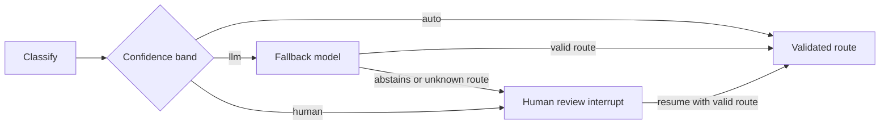

# jev-lanes

Confidence-based routing and escalation policies for Jev and LangGraph.

**v0.1 release candidate:** the repository implements confidence-band selection, the
serializable `RouteTrace`, the `Classifier`/`FallbackModel` protocols, offline fakes and
`JevRouter`, which wires the three lanes and a resumable human review into a LangGraph
`StateGraph`, plus default adapters for TypeSafe and any LangChain chat model (bring your
own keys). Offline examples and a five-minute notebook demonstrate the full flow.
The [37-case synthetic smoke battery](benchmarks/results/2026-10-20-battery.md)
shows integration behavior; it does not establish decision quality or calibrated
thresholds. `langchain-typesafe` itself is an alpha release. The package has not been
published to PyPI; install from this checkout.

## Why

Routing needs an explicit policy for uncertainty: when to accept a classifier's
decision, ask another model, or request human judgment. This project aims to make
that policy testable and auditable, including resuming a graph after human review.

The implemented flow is:

```text
Jev Choice -> confidence band
               auto  -> validated Jev route
               llm   -> fallback model -> validated route or human review
               human -> interrupt -> validated human decision -> route
```



The fallback model's benefit must be evaluated. A valid route name alone does not
establish a correct decision. Jev confidence is a distribution statistic, not an
accuracy guarantee; thresholds depend on the task and its consequences.

## Try the current policy locally

Requires Python 3.10+ and [uv](https://docs.astral.sh/uv/getting-started/installation/).
From this checkout:

```bash
uv sync --locked --dev
uv run python examples/policy.py
```

For an application environment, `python -m pip install .` installs the package from
the checkout. No provider keys are needed to import it or run the offline examples.

```python
from jev_lanes import Lanes

# Illustrative thresholds, not calibrated defaults.
lanes = Lanes(auto=0.85, llm=0.60)
assert lanes.lane_for(0.95) == "auto"
assert lanes.lane_for(0.70) == "llm"
assert lanes.lane_for(0.40) == "human"
```

## Try the router offline

`examples/router_offline.py` runs all three lanes and a human review resumed with a
checkpointer, using fakes instead of providers:

```bash
uv run python examples/router_offline.py
```

```python
from typing import Any, TypedDict

from langgraph.graph import END, START, StateGraph

from jev_lanes import Classification, JevRouter, Lanes
from jev_lanes.testing import FakeFallback, FakeJevClassifier


class State(TypedDict, total=False):
    messages: list[str]
    support_route: dict[str, Any]
    handled_by: str


router = JevRouter(
    name="support",
    routes={"orders": "Order status questions", "billing": "Invoices and payments"},
    lanes=Lanes(auto=0.85, llm=0.60),
    classifier=FakeJevClassifier(Classification("orders", 0.95)),
    fallback=FakeFallback(),
)
builder = StateGraph(State)
builder.add_node("intake", lambda state: {})
builder.add_node("orders", lambda state: {"handled_by": "orders"})
builder.add_node("billing", lambda state: {"handled_by": "billing"})
builder.add_edge(START, "intake")
router.attach(builder, after="intake")  # route names are the target node names
builder.add_edge("orders", END)
builder.add_edge("billing", END)
result = builder.compile().invoke({"messages": ["Where is my parcel?"]})
assert result["handled_by"] == "orders"
```

- Declare `router.state_key` (here `support_route`) in your graph state schema; it holds
  the serializable `RouteTrace`. Every invocation starts a new episode.
- By default the state's `messages` are sent to the providers; pass `extract=` to send
  something else or to redact. Case text is never stored in the trace or in the
  review request.
- The fallback model abstaining or naming an unknown route escalates to human review.
  Provider failures raise; they are not converted into a low confidence.
- Human review needs a checkpointer and a stable `thread_id`. Resume with
  `Command(resume="<route>")`; an unknown route is rejected and can be sent again.
  Resuming does not classify again.
- Sync only; requires `langgraph>=1.2.12`.
- The trace replaces its previous episode in `<name>_route` (no list reducer).
  Checkpointers retain state snapshots according to their own retention policy, including
  the case text in `messages`. `InMemorySaver` only persists within the current process.

## Full demos

```bash
uv run --offline --no-sync python examples/atendimento/demo.py
uv run --offline --no-sync python examples/manual_routing.py
```

The [customer-service demo](examples/atendimento/README.md) handles orders, billing and
account questions. It demonstrates fallback abstention, an invalid human response and
successful resumption without reclassifying. Human responses are scripted.

The [manual example](examples/manual_routing.py) expands the edges that `attach()`
adds, using the same public node methods. Behavior comparisons cover all three lanes,
invalid review/retry, provider failures, mapped/shared destinations, `END` and a new
episode. This comparison validates graph wiring, not accuracy or a speed advantage.

Open [the five-minute notebook](examples/quickstart.ipynb) in a notebook editor using
the project interpreter, or execute it from the terminal:

```bash
uv sync --locked --dev --group notebook
uv run --offline --no-sync python examples/execute_notebook.py
```

The executed copy goes to `build/quickstart.executed.ipynb`; source cells stay clean.

## Use real providers (bring your own keys)

```python
from jev_lanes.adapters import JevClassifier, LangChainFallback

router = JevRouter(
    name="support",
    routes={"orders": "...", "billing": "...", "other": "Anything else."},
    lanes=Lanes(auto=0.85, llm=0.60),
    classifier=JevClassifier(),  # reads TYPESAFE_API_KEY
    fallback=LangChainFallback("openai:gpt-5-nano"),
)
```

`JevClassifier` asks TypeSafe a `Choice` whose criteria are your routes (add an `other`
route when they may not cover every input). `LangChainFallback` takes a `BaseChatModel`
or an `init_chat_model` string; install the provider package yourself (for example
`langchain-openai`) and set that provider's key. Keys are never stored or forwarded by
this package. The case text is sent to TypeSafe and, for medium-confidence cases, to the
fallback provider. `examples/byok.py` is a complete example; it calls real services and
is not run in CI.

The fallback model is asked for a route name or `ABSTAIN` in plain text, and the reply
is checked against your routes: anything else escalates to human review.

## The lane policy

Thresholds must satisfy `0 <= llm < auto <= 1`. Equality with either threshold
selects the higher band. Invalid confidence raises an error; a provider failure
is not treated as a low-confidence decision. The package itself never calls external
services; only the providers you inject do.

## Development

```bash
uv run --offline --no-sync ruff check .
uv run --offline --no-sync ruff format --check .
uv run --offline --no-sync pytest
uv build
```

Install dependencies with `uv sync --locked --dev` before running offline checks.
The CI workflow targets Python 3.10–3.14. Distribution builds require a cached
build backend or network access.

## Repository

- `src/jev_lanes/`: public policy primitives, with type annotations
  (`lanes`, `trace`, `protocols`, `router`, `adapters`, and `testing` fakes for offline tests).
- `tests/`: deterministic offline tests.
- `examples/`: policy, offline router, customer-service and manual wiring examples,
  a five-minute notebook, and a BYOK example that needs keys.
- `benchmarks/`: synthetic smoke results and the protocol for a separate real-data evaluation.
- [Decisions](docs/DECISIONS.md): accepted choices, open questions and ADR index.
- [Implementation plan](docs/PLAN.md): MVP and follow-up scope.
- [Glossary](GLOSSARY.md): domain terminology.
- [Contributing](CONTRIBUTING.md): local workflow and evaluation expectations.
- [Changelog](CHANGELOG.md) and [release process](docs/RELEASE.md).

## Naming and related work

[`langgraph-jev-router`](https://pypi.org/project/langgraph-jev-router/) is an existing
third-party project. This is a separate project centered on an explicit three-band
escalation policy. `jev-lanes` returned HTTP 404 from PyPI's public project JSON
endpoint on 2026-10-19; that is not a reservation or publication guarantee.

## References

- [Official LangChain TypeSafe integration](https://docs.langchain.com/oss/python/integrations/providers/typesafe)
- [TypeSafe confidence guidance](https://docs.typesafe.ai/confidence)
- [LangGraph interrupts](https://docs.langchain.com/oss/python/langgraph/interrupts)

MIT licensed. Independent project; not affiliated with TypeSafe or LangChain.
