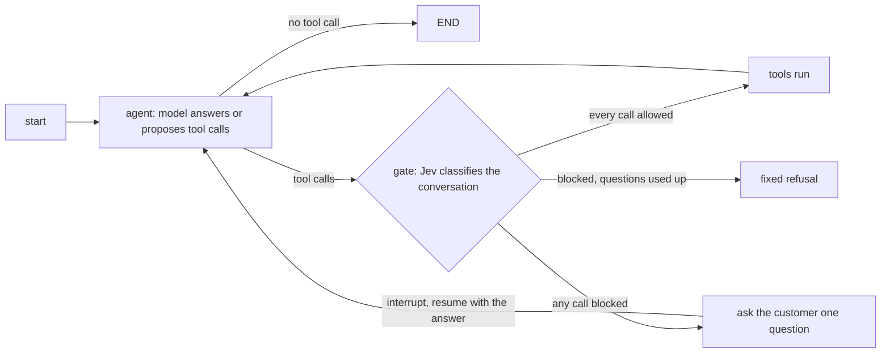

# jev-lanes

Confidence-gated tools for LangGraph agents, with [Jev](https://docs.typesafe.ai/confidence)
(TypeSafe) as the classifier.

**Status:** release candidate, not published to PyPI (install from this checkout). The
package name comes from an earlier three-lane design and may change before any
publication. `langchain-typesafe` itself is an alpha release.

## Why

A tool-calling agent decides *what* to do with a language model, and nothing in that
decision says how sure anyone is that it understood the customer. For a read-only lookup
that hardly matters; for a refund it does. `jev-lanes` puts a second opinion in front of
every tool call: Jev classifies the conversation, and each tool declares the confidence it
needs before it may run.

```python
GatedTool(order_status, intents=["orders"], min_confidence=0.50)  # read-only
GatedTool(refund, intents=["billing"], min_confidence=0.90)  # cannot be undone
```

## How it works



- A call is allowed when Jev's intent is one of the tool's `intents` **and** its confidence
  is at least `min_confidence` (equality allows). A confident but different intent blocks
  the call too.
- All or nothing: if one call in a step is blocked, none run. Every call still gets an
  error result, because providers require one per call.
- A blocked step makes the agent ask the customer one short question. The graph pauses on
  LangGraph's `interrupt()` and continues when you resume it with the answer. Classification
  is not repeated on resume.
- After `max_clarifications` questions (default 2) the turn ends with a fixed refusal. No
  tool with a side effect has run.
- Jev is called only when the model proposes a tool call, so small talk costs nothing. A
  provider failure raises; it is never turned into a low confidence.
- There is no human-review step. Handing off to a person, if you want it, is a tool.

## Try it offline

No keys, no network:

```bash
uv sync --locked --dev
uv run python examples/atendimento/demo.py
```

```python
from langchain_core.messages import HumanMessage
from langchain_core.tools import tool
from langgraph.checkpoint.memory import InMemorySaver
from langgraph.types import Command

from jev_lanes import Classification, GatedAgent, GatedTool
from jev_lanes.testing import FakeChatModel, FakeJevClassifier, tool_call_message


@tool
def refund(order_id: str) -> str:
    """Refund an order in full."""
    return f"{order_id} refunded"


agent = GatedAgent(
    model=FakeChatModel(
        tool_call_message("refund", {"order_id": "A1"}, id="1"),
        "Which order, and what went wrong?",
        tool_call_message("refund", {"order_id": "A1"}, id="2"),
        "Refunded.",
    ),
    tools=[GatedTool(refund, intents=["billing"], min_confidence=0.9)],
    intents={"billing": "Charges and refunds.", "orders": "Delivery and tracking."},
    classifier=FakeJevClassifier(Classification("billing", 0.6), Classification("billing", 0.96)),
)
graph = agent.compile(InMemorySaver())  # asking needs a checkpointer and a stable thread_id
config = {"configurable": {"thread_id": "t1"}}

paused = graph.invoke({"messages": [HumanMessage("I want my money back")]}, config)
print(paused["__interrupt__"][0].value)  # {'question': 'Which order, ...?', 'round': 1}
done = graph.invoke(Command(resume="Order A1 arrived broken"), config)
print(done["messages"][-1].text)  # Refunded.
```

The [customer-service demo](examples/atendimento/demo.py) walks three conversations: a
clear request that acts, a vague one that asks and then acts, and one that never becomes
clear and is refused. The classifier there is scripted, so it shows the wiring, not how
well Jev classifies.

## Use real providers (bring your own keys)

```python
from langchain.chat_models import init_chat_model

from jev_lanes.adapters import JevClassifier

agent = GatedAgent(
    model=init_chat_model("openai:gpt-5-nano"),  # any tool-calling LangChain chat model
    tools=[...],
    intents={...},
    classifier=JevClassifier(),  # reads TYPESAFE_API_KEY
)
```

`JevClassifier` asks TypeSafe a `Choice` whose criteria are your intents. Install your chat
model's provider package (for example `langchain-openai`) and set its key.
[`examples/atendimento/byok.py`](examples/atendimento/byok.py) is a complete chat loop; it
calls real services and is not run in CI. Keys are never stored or forwarded by this package.

## Evidence

Evaluated once on [Banking77](https://huggingface.co/datasets/PolyAI/banking77) (66 intents
grouped into four routes, 11 held-out intents with no correct route; 770 test messages).
Full method, sweep and limitations: [gate report](benchmarks/results/banking77/gate-report.md).

At the threshold fixed before the run (0.995), with the same Jev answers throughout:

| Policy | Served correctly | Harmful acts | In-scope customers not served |
|---|---|---|---|
| always act on Jev's route | 608 | 162 | 0 |
| gate, no questions | 418 | 25 | 238 |
| gate, up to 2 questions | 501 | 41 | 155 |

A harmful act is an action on the wrong route or on a message the desk cannot serve.

- **The gate works as a brake.** It cuts harmful acts from 162 to 25.
- **Asking recovers some blocked customers**: 83 of the 238, none of them sent to a wrong
  route. The extra 16 harmful acts are all out-of-scope messages that Jev, with no
  catch-all route, still pushed into one of the four routes.
- **Asking is only a little better than lowering the threshold.** Against a plain gate with
  the same budget of harmful acts, the gain at the fixed threshold is +9 customers served
  (95% interval −8 to +26): not distinguishable from zero. At thresholds 0.7–0.95 it is
  +19 to +24 (about 2.5–3% of customers). This comparison was added after seeing the first
  numbers.
- **The simulated customer favours asking.** The reply to the agent's question is another
  Banking77 message of the same intent, always fluent and on topic. Real customers may add
  nothing or not answer, so read the gain as an upper bound.

Not measured: the agent's language model (which tool it proposes, how it phrases the
question), real customers, other languages or domains. One dataset, one run. Confidence is
a distribution statistic, not an accuracy guarantee; choose `min_confidence` per tool with
your own labelled data.

### What did not work

The first design routed medium-confidence cases to a second LLM. On the same data it did
not help: of 134 cases below the automatic threshold it fixed 12 of Jev's answers and broke
16 (sign test p = 0.57), and the 95% automatic-accuracy target was not reached. That design
was dropped. The [report](benchmarks/results/banking77/report.md) is kept as history.

## Privacy and security

- The package calls no service itself; the providers you inject do. The conversation text
  goes to TypeSafe and to your chat model's provider. By default the classifier receives only
  customer and assistant text, not tool calls or tool results; pass `extract=` to the agent
  to restrict or redact further.
- `GateTrace` (state key `gate`) records tool, intent, confidence, requirement and outcome.
  It never holds message text or tool arguments. Graph state and checkpoints do hold the
  messages; retention is your checkpointer's policy.
- The gate decides *whether* a tool may run, not *with which arguments*. Validate arguments
  inside the tool, and treat the customer's replies as untrusted input to the model.

See [SECURITY.md](SECURITY.md).

## Development

```bash
uv sync --locked --dev
uv run --offline --no-sync ruff check .
uv run --offline --no-sync ruff format --check .
uv run --offline --no-sync mypy
uv run --offline --no-sync pytest
uv run --offline --no-sync python examples/atendimento/demo.py
```

Python 3.10+; CI covers 3.10–3.14. Synchronous only; requires `langgraph>=1.2.12`.

## Repository

- `src/jev_lanes/`: `GatedTool` (`gate.py`), `GatedAgent` (`agent.py`), `GateTrace`
  (`trace.py`), the `Classifier` protocol, the TypeSafe `adapters`, and `testing` fakes.
- `tests/`: deterministic offline tests, including the replay logic of the evaluation.
- `examples/atendimento/`: offline demo and a bring-your-own-keys chat.
- `benchmarks/`: the Banking77 gate evaluation (`clarify.py`, `gate_report.py`) and the
  archived three-lane evaluation.
- [Glossary](GLOSSARY.md) · [Contributing](CONTRIBUTING.md) · [Changelog](CHANGELOG.md)

## Naming and related work

[`langgraph-jev-router`](https://pypi.org/project/langgraph-jev-router/) is an existing
third-party project. This is a separate project. `jev-lanes` returned HTTP 404 from PyPI's
public project JSON endpoint on 2026-10-19; that is not a reservation or publication
guarantee, and the name no longer describes the design.

## References

- [Official LangChain TypeSafe integration](https://docs.langchain.com/oss/python/integrations/providers/typesafe)
- [TypeSafe confidence guidance](https://docs.typesafe.ai/confidence)
- [LangGraph interrupts](https://docs.langchain.com/oss/python/langgraph/interrupts)

MIT licensed. Independent project; not affiliated with TypeSafe or LangChain.
